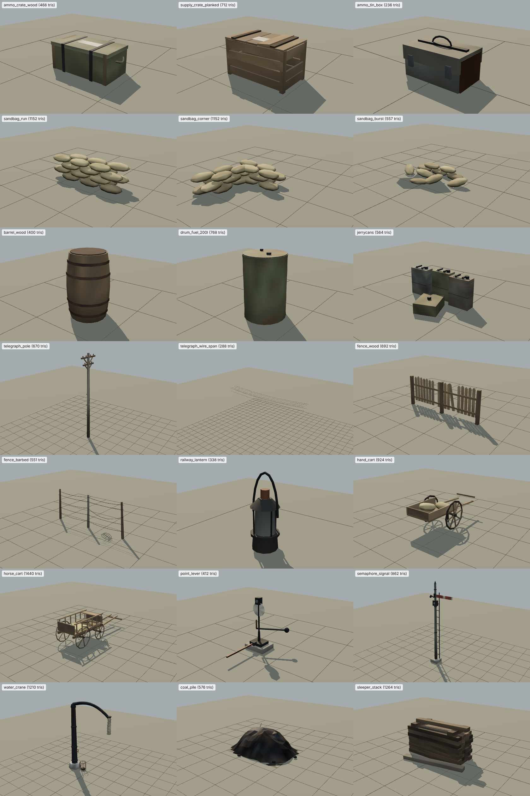

# Kit de props de M01 (T12, `M01-PROP-KIT-V1`)

Props originais de guerra e ferrovia para o campo de batalha de Tczew (Setembro de 1939), para substituir caixas e fios do protótipo. **Provisório verificado; ainda não ligado ao jogo** (a ligação é a tarefa T33; nada em `src/` foi alterado). Geometria, cores e materiais são criados por código neste repositório (autor "COD-guerra project, original procedural", licença ainda por decidir pelo proprietário, como os outros assets provisórios (ASSET_CREDITS.md)). Nenhum modelo, textura ou fotografia de terceiros, nada extraído de jogos, sem dependências npm.

- Ficheiros: `assets/models/provisional/m01/props/` (21 props × LOD0/LOD1 = 42 GLB + `manifest.json` com bytes, sha256, triângulos, vértices, materiais e bounds por ficheiro).
- Gerador: `tools/assets/m01-props/` (`node tools/assets/m01-props/build.mjs`, `--check` compara com o disco). Determinístico: voltar a correr dá os mesmos bytes.
- Teste: `tests/m01-props-kit.test.js` (reprodução byte a byte, manifesto, orçamentos, tamanhos reais, origem no solo, cores dessaturadas, GLB válidos, âncoras do fio) e `tests/assets-manifests.test.js` (autor/licença/unidades).
- Capturas: `node tools/assets/m01-props/render/capture.mjs [id ...]` (Chromium do Playwright + `GLTFLoader` do three.js, luz de madrugada) escreve `docs/assets/m01-props/captures/<id>.png` (LOD0 à esquerda, LOD1 à direita, mesma câmara) e `overview.png`. Chromium: `CHROME_EXECUTABLE` ou `/opt/pw-browsers/chromium-1194/chrome-linux/chrome`.

## Convenções

- Metros; +Y para cima; origem no contacto com o solo (o teste exige a base entre −2 cm e +3 cm, excepto o vão de fio, que está no ar). Troços longos (cercas, fio, travessas, sacos) ao longo de X; carroça de cavalo, carrinho de mão e alavanca com a frente ou o tirante para ±Z como indicado abaixo.
- Orçamentos: LOD0 ≤ 1 500 triângulos, LOD1 ≤ 300 por prop (o teste falha se forem excedidos). O LOD1 mantém a pegada do LOD0 (±12 % ou 15 cm).
- Cor por vértice (`COLOR_0`, linear), sem texturas nem UV: paleta dessaturada e suja (nenhum vértice com saturação sRGB > 0,62) e envelhecimento procedural comum (lama junto ao chão, pó nas faces de cima, baixos mais escuros). Materiais PBR partilhados por nome (`wood`, `steel`, `cloth`, `coal`…) com rugosidade/metalicidade moderadas (metalicidade ≤ 0,5; sem mapa de ambiente os metais escuros ficam quase pretos).
- Sockets (`nodes[0].extras.sockets` e `manifest.json`): `telegraph_pole.wire_anchors` (seis âncoras de fio) e `telegraph_wire_span.start_anchors/span_end_anchors` (o vão de 12 m liga as âncoras de dois postes iguais a 12 m); `semaphore_signal.arm_pivot/lamp_lens`; `water_crane.spout_tip`.
- O fio é um vão separado (`telegraph_wire_span`, 12 m, flecha 0,28 m) para o jogo o repetir/rodar por vão entre postes.

## Lista, tamanhos e triângulos

| Prop | Categoria | Tamanho X × Y × Z (m) | LOD0 / LOD1 (tri) | Ficheiros | Captura |
|---|---|---|---|---|---|
| `ammo_crate_wood` — Caixa de munição de madeira | crates | 0,92 × 0,35 × 0,43 | 468 / 48 | `m01_prop_ammo_crate_wood_lod0.glb`, `m01_prop_ammo_crate_wood_lod1.glb` | [png](captures/ammo_crate_wood.png) |
| `supply_crate_planked` — Caixa de mantimentos de tábuas | crates | 0,90 × 0,55 × 0,52 | 712 / 240 | `m01_prop_supply_crate_planked_lod0.glb`, `m01_prop_supply_crate_planked_lod1.glb` | [png](captures/supply_crate_planked.png) |
| `ammo_tin_box` — Caixa metálica de munição | crates | 0,42 × 0,26 × 0,25 | 236 / 36 | `m01_prop_ammo_tin_box_lod0.glb`, `m01_prop_ammo_tin_box_lod1.glb` | [png](captures/ammo_tin_box.png) |
| `sandbag_run` — Sacos de areia: troço recto | sandbags | 2,10 × 0,58 × 0,62 | 1152 / 144 | `m01_prop_sandbag_run_lod0.glb`, `m01_prop_sandbag_run_lod1.glb` | [png](captures/sandbag_run.png) |
| `sandbag_corner` — Sacos de areia: canto em L | sandbags | 1,51 × 0,44 × 1,81 | 1152 / 144 | `m01_prop_sandbag_corner_lod0.glb`, `m01_prop_sandbag_corner_lod1.glb` | [png](captures/sandbag_corner.png) |
| `sandbag_burst` — Sacos de areia: rebentado | sandbags | 2,24 × 0,30 × 1,65 | 557 / 210 | `m01_prop_sandbag_burst_lod0.glb`, `m01_prop_sandbag_burst_lod1.glb` | [png](captures/sandbag_burst.png) |
| `barrel_wood` — Barril de madeira | barrels | 0,58 × 0,89 × 0,58 | 400 / 80 | `m01_prop_barrel_wood_lod0.glb`, `m01_prop_barrel_wood_lod1.glb` | [png](captures/barrel_wood.png) |
| `drum_fuel_200l` — Bidão de combustível de 200 l | barrels | 0,60 × 0,91 × 0,60 | 768 / 140 | `m01_prop_drum_fuel_200l_lod0.glb`, `m01_prop_drum_fuel_200l_lod1.glb` | [png](captures/drum_fuel_200l.png) |
| `jerrycans` — Jerricans (grupo) | barrels | 1,14 × 0,50 × 0,79 | 564 / 84 | `m01_prop_jerrycans_lod0.glb`, `m01_prop_jerrycans_lod1.glb` | [png](captures/jerrycans.png) |
| `telegraph_pole` — Poste de telégrafo | line | 0,32 × 7,00 × 1,60 | 670 / 174 | `m01_prop_telegraph_pole_lod0.glb`, `m01_prop_telegraph_pole_lod1.glb` | [png](captures/telegraph_pole.png) |
| `telegraph_wire_span` — Vão de fio de telégrafo | line | 12,00 × 0,81 × 1,25 | 288 / 144 | `m01_prop_telegraph_wire_span_lod0.glb`, `m01_prop_telegraph_wire_span_lod1.glb` | [png](captures/telegraph_wire_span.png) |
| `fence_wood` — Cerca de ripas de madeira | fences | 3,00 × 1,15 × 0,18 | 692 / 156 | `m01_prop_fence_wood_lod0.glb`, `m01_prop_fence_wood_lod1.glb` | [png](captures/fence_wood.png) |
| `fence_barbed` — Cerca de arame farpado | fences | 3,09 × 1,30 × 0,63 | 551 / 189 | `m01_prop_fence_barbed_lod0.glb`, `m01_prop_fence_barbed_lod1.glb` | [png](captures/fence_barbed.png) |
| `railway_lantern` — Lanterna ferroviária de mão | rail | 0,15 × 0,36 × 0,14 | 338 / 164 | `m01_prop_railway_lantern_lod0.glb`, `m01_prop_railway_lantern_lod1.glb` | [png](captures/railway_lantern.png) |
| `hand_cart` — Carrinho de mão de estação | carts | 1,17 × 0,99 × 2,67 | 924 / 218 | `m01_prop_hand_cart_lod0.glb`, `m01_prop_hand_cart_lod1.glb` | [png](captures/hand_cart.png) |
| `horse_cart` — Carroça de cavalo (silhueta) | carts | 1,45 × 1,38 × 4,58 | 1440 / 276 | `m01_prop_horse_cart_lod0.glb`, `m01_prop_horse_cart_lod1.glb` | [png](captures/horse_cart.png) |
| `point_lever` — Alavanca de agulha | rail | 0,93 × 1,28 × 1,45 | 412 / 194 | `m01_prop_point_lever_lod0.glb`, `m01_prop_point_lever_lod1.glb` | [png](captures/point_lever.png) |
| `semaphore_signal` — Semáforo mecânico | rail | 1,78 × 5,67 × 0,56 | 862 / 240 | `m01_prop_semaphore_signal_lod0.glb`, `m01_prop_semaphore_signal_lod1.glb` | [png](captures/semaphore_signal.png) |
| `water_crane` — Grua de água | rail | 3,24 × 4,67 × 0,84 | 1210 / 235 | `m01_prop_water_crane_lod0.glb`, `m01_prop_water_crane_lod1.glb` | [png](captures/water_crane.png) |
| `coal_pile` — Monte de carvão | rail | 3,37 × 1,20 × 2,54 | 576 / 70 | `m01_prop_coal_pile_lod0.glb`, `m01_prop_coal_pile_lod1.glb` | [png](captures/coal_pile.png) |
| `sleeper_stack` — Pilha de travessas | rail | 3,01 × 1,50 × 1,78 | 1264 / 156 | `m01_prop_sleeper_stack_lod0.glb`, `m01_prop_sleeper_stack_lod1.glb` | [png](captures/sleeper_stack.png) |

## Descrição e referências

As referências históricas são só em palavras (proporções gerais de equipamento corrente em 1939 na Polónia e na Alemanha); não houve cópia de modelos, plantas ou imagens.

- **`ammo_crate_wood`** — Caixa de munição de madeira verde-oliva gasta, tampa com cintas de aço e pegas de corda nas cabeceiras. Referência (só em palavras): Caixas de munição e de mantimentos de madeira com cintas, de tipo corrente nos exércitos polaco e alemão em 1939; proporções de memória do tipo, sem cópia de peças reais.
- **`supply_crate_planked`** — Caixa de tábuas com prumos de canto, uma tábua partida e uma da tampa levantada. Referência (só em palavras): Caixas de munição e de mantimentos de madeira com cintas, de tipo corrente nos exércitos polaco e alemão em 1939; proporções de memória do tipo, sem cópia de peças reais.
- **`ammo_tin_box`** — Caixa de chapa de aço cinzento-campanha com tampa, pega, dois fechos e ferrugem. Referência (só em palavras): Caixas de munição e de mantimentos de madeira com cintas, de tipo corrente nos exércitos polaco e alemão em 1939; proporções de memória do tipo, sem cópia de peças reais.
- **`sandbag_run`** — Parapeito recto de quatro fiadas, dois sacos de espessura, ligação em quincôncio (cada saco 0,6 × 0,3 × 0,15 m). Referência (só em palavras): Parapeitos de sacos de areia improvisados em postos de 1939; sacos de serapilheira atados nas pontas.
- **`sandbag_corner`** — Canto em L de três fiadas com duas pernas de 1,2 m e dois sacos de espessura. Referência (só em palavras): Parapeitos de sacos de areia improvisados em postos de 1939.
- **`sandbag_burst`** — Parapeito desfeito: fiadas incompletas, sacos caídos, um saco rasgado e areia derramada. Referência (só em palavras): Danos de explosão sobre sacos de areia.
- **`barrel_wood`** — Barril de aduelas com quatro arcos de ferro; aduelas de tons diferentes. Referência (só em palavras): Barril de tanoaria comum (água, conservas), ø ≈ 0,58 m.
- **`drum_fuel_200l`** — Bidão de chapa de 200 l com duas nervuras de reforço, dois bujões e tinta verde-oliva gasta com ferrugem. Referência (só em palavras): Bidão de chapa de 200 litros de uso militar e civil da época (ø ≈ 0,585 m).
- **`jerrycans`** — Três jerricans de 20 l de pé e um deitado, em tons de aço cinzento e ferrugem. Referência (só em palavras): Wehrmachtskanister de 20 l (introduzido em 1937–1939), 0,34 × 0,16 × 0,46 m.
- **`telegraph_pole`** — Poste de madeira de 7 m, base creosotada, dois braços com escoras e seis isoladores de porcelana; âncoras de fio nos sockets. Referência (só em palavras): Equipamento de via das ferrovias do Estado polaco (PKP) e alemãs (Reichsbahn) de 1939: material fundido ou de madeira creosotada pintado de forma utilitária.
- **`telegraph_wire_span`** — Seis fios de 12 m com flecha de 0,28 m entre as âncoras de dois postes iguais (x=0 e x=12); repetir por vão. Referência (só em palavras): Equipamento de via das ferrovias do Estado polaco (PKP) e alemãs (Reichsbahn) de 1939: material fundido ou de madeira creosotada pintado de forma utilitária.
- **`fence_wood`** — Secção de 3 m com três postes, duas travessas e ripas pontiagudas, algumas em falta ou tortas. Referência (só em palavras): Cerca rural de ripas de aldeia europeia.
- **`fence_barbed`** — Secção de 3 m com três estacas inclinadas, cinco fios com flecha e farpas, e um rolo caído. Referência (só em palavras): Cerca de arame farpado de campo.
- **`railway_lantern`** — Lanterna de petróleo de chapa escura com vidro sujo, grelha e alça. Referência (só em palavras): Lanterna de mão de ferroviário, tipo de furacão.
- **`hand_cart`** — Carrinho de duas rodas de raios com aro de ferro, plataforma de tábuas e varais para −Z, com dois sacos. Referência (só em palavras): Carrinho de bagagem e carga de estação.
- **`horse_cart`** — Carroça de escadas de quatro rodas com banco, timão e balança para −Z; sem cavalo. Referência (só em palavras): Carroça agrícola de escadas polaca (wóz drabiniasty).
- **`point_lever`** — Alavanca de mão de agulha com alvo de duas faces, lanterna, braço com contrapeso e tirante para a via (−Z→+Z). Referência (só em palavras): Equipamento de via das ferrovias do Estado polaco (PKP) e alemãs (Reichsbahn) de 1939: material fundido ou de madeira creosotada pintado de forma utilitária.
- **`semaphore_signal`** — Mastro tubular de 5,5 m com escada, braço horizontal (parar) a +X, lanterna de espectáculo e fio de transmissão. Referência (só em palavras): Equipamento de via das ferrovias do Estado polaco (PKP) e alemãs (Reichsbahn) de 1939: material fundido ou de madeira creosotada pintado de forma utilitária.
- **`water_crane`** — Coluna de ferro fundido de 4,6 m, braço em pescoço de cisne para +X, manga de lona, roda de válvula e braseiro anti-gelo. Referência (só em palavras): Equipamento de via das ferrovias do Estado polaco (PKP) e alemãs (Reichsbahn) de 1939: material fundido ou de madeira creosotada pintado de forma utilitária.
- **`coal_pile`** — Monte facetado de carvão com pedaços soltos e uma pá cravada. Referência (só em palavras): Depósito de carvão de tender de estação.
- **`sleeper_stack`** — Oito fiadas de quatro travessas de 2,6 m, calços em cruz e uma travessa caída. Referência (só em palavras): Travessas de via de madeira creosotada, 2,6 × 0,26 × 0,15 m.

## Limitações

- Sem texturas nem normal maps: o detalhe fino (tábuas, farpas, costuras) depende da geometria e da cor de vértice; o conjunto é adequado a distância de jogo, não a grandes planos. Um atlas de produção pode ser pedido em T09.
- Os tamanhos são aproximações de tipos correntes (não medições de peças reais); estimativas conhecidas: espessura dos sacos, comprimento do vão de fio, geometria da grua de água.
- Sem animação (braço do semáforo, alavanca, grua, rodas): cada prop é uma malha única; o braço do semáforo está na posição "parar".
- O vão de fio usa secção triangular de 12 mm e só é legível de perto/em contraluz; a flecha é parabólica.
- Capturas feitas em SwiftShader (software); não representam desempenho nem o aspecto final do jogo. Nenhum FPS foi medido.
