# T38 · M01-COMBAT-POSTURE-STAGING-V1 — evidência

Estado: **entregue na branch, NÃO aceite** (falta revisão crítica independente da versão final, CI x86 completo e playtest humano).
Base: predecessor `ef35c7a` (fatia 1 de T38) → fatia 2 (jogo), retomada em 2026-10-17 na branch `claude/busy-ritchie-3fkvk2-t38` (cabeça do PR #82
`2bc623c` + candidata #80 `813f163` + correcção de teste #89 `b449007`), com as correcções da revisão crítica de `8bb0372` (REJECT; ver `HANDOFF.md`).
Segunda revisão crítica (sobre `65145c9`): REQUEST_CHANGES, sem defeito de código. Esta versão responde-lhe: (1) o desvio do fogo da MG34 está medido por rota e a frase errada «é o do RNG» foi corrigida
(«Mudança sistemática…» abaixo), com a decisão do Captain **D40** em `docs/direction/DECISIONS.md`; (2) a base T48 (`5a169ba`: candidata #80 + #89 + retirada alemã) entrou na branch (merge `f02e06b`) e o golden foi
re-derivado sobre a simulação combinada (emenda 02, mais a prova causal `german-retreat-regroup-v1/GOLDEN_AMENDMENT_03.json`); (3) a migração de saves já não move um atirador dos portões caído.
As capturas "antes" são de `ef35c7a` (worktree separado, mesmo spec); as "depois" são da árvore anterior à fusão (`65145c9`; ver «Capturas»). Chromium 1194 headless, SwiftShader,
1280×720 reduzido a 960×540 (PNG de 256 cores). Não é playtest humano e não mede FPS.

## O que mudou no jogo

| Grupo | Antes | Depois (dados em `missions/m01-tczew/mission.json`) |
| --- | --- | --- |
| Pelotão leste (24) | grelha 6×4 (x 1033–1043, z 38,2–41,8), de pé em jogo; só desenhado agachado (fatia 1) | `hold.slots`: 24 lugares desencontrados (x 1028–1043, z 38,2–41,8, mínimo 1,3 m, nenhum trio em fila cerrada nem quatro em linha); as reservas pl_east_18..23 na faixa sul (z ≥ 41,4), todas mais a sul do que qualquer um dos outros dezoito (z ≤ 40,8); **de joelhos em jogo** (`crouched`) durante a espera, de pé na retirada |
| Atiradores dos portões (`de_east_2..13`) | dente de serra x 1053/1055/1057, z 9,5–31,5, de pé, virados a leste, os de x 1053 a flutuar 0,4 m | `positions` [x, z, facing] desencontrados em profundidade (x 1053,2–1058,3, na faixa x ≥ 1053 de T23) na encosta entre as pontes, à frente do portal de 1912, virados a oeste, **de joelhos em jogo**; levantam-se 1,2 s antes de disparar e ficam de pé 2,5 s depois (a janela em que a apresentação os mostra a apontar); também se levantam para cada salva de atrito (T23), até 2,5 s depois da queda. Cada lugar mantém exactamente as linhas de visão do lugar antigo nas posições amostradas da rota e nos pontos da estação, do abrigo e do corredor |
| Secção no posto (`cv_squad_post`) | fila de pé x −76 a −92 | `grp_squad.stage.slots` atrás dos sacos, todos dentro do comprimento deles (z 20,5–23,5); desde o bombardeamento das 04:34, de joelhos no lugar; nenhuma das 40 posições alemãs vê um homem de joelhos ali. Kowal (rkm) levanta-se por cima dos sacos 0,5 s antes de cada rajada e fica de pé 0,8 s (a rajada); de pé vê os portões |
| Sapadores | três na mesma recta, dois a 0,6 m | `grp_sappers.stage.slots` espaçados junto ao cabo, de joelhos a trabalhar; no segundo corte: agachados a trabalhar, deitados (T07) quando suprimidos ou à espera parados junto ao corte; depois da retirada, em x −170, de joelhos (não há fogo ali). Os lugares do segundo corte, a supressão a 3 m e o ritmo do trabalho (150 s) não mudam |

Coerência: a hitbox (`spatial.js actorHitboxes`), os olhos (`eyePosition`, linha de visão), o ponto visado por quem dispara contra
o homem (`src/game/m01-aim.js aimPoint`, também usado pelos traçantes de exibição) e a origem dos tiros dele saem todos do mesmo
`crouched`/`posture` que o renderer desenha. O tiro de atrito sai sempre de um homem de pé.

**Cobertura — sem exagero.** A secção ajoelhada fica realmente coberta pelos sacos (verificado por linha de visão). Os sapadores e o
pelotão não têm cobertura sólida nova: baixam a silhueta (de joelhos/deitados) e espalham-se. Os atiradores dos portões **não têm
cobertura vinda de oeste**: o único colisor junto aos portões é o portal de 1912 (atrás deles) e a encosta desce para o rio; escondê-los
atrás do fim dos tabuleiros cortar-lhes-ia a linha de visão com que disparam sobre o jogador. Sem novos props de cobertura (fora do
âmbito "só posições") a melhoria possível é profundidade, alturas diferentes e postura.

**Saves antigos.** Ao carregar um save anterior a T38, quem estiver vivo exactamente no seu lugar antigo (e não tiver sido mandado para
lado nenhum) passa para o lugar novo; quem já se moveu, e quem já caiu (um atirador dos portões caído fica onde caiu), fica onde está.

## Efeitos no jogo (auditoria de 12 sementes × 2 rotas, `GOLDEN_AUDIT.json`)

Gerada por `tools/verification/m01-combat-posture-staging-audit.mjs` (predecessor `5a169ba` = base T48, a candidata #80 + #89 + retirada alemã, contra esta árvore, as mesmas rotas de controlo reais, x86,
Node 22.22.0, 24 pares de simulações completas); a ferramenta falha se uma só das invariantes seguintes não se mantiver, e saiu com 0. A mesma auditoria **antes da fusão com T48**
(predecessor `ef35c7a`, árvore `d171fd1`, `GOLDEN_AUDIT_PRE_T48.json`) dá os mesmos resultados, campo a campo, em 21 das 24 rotas. Diferem 3: semente 2 sem apoio (predecessor: acertos no jogador 2 → 1, saúde final 84 → 92, `enemy-fire` 1978 → 1971); semente 4 sem apoio (predecessor: acertos no jogador 0 → 1, saúde final 100 → 92, `enemy-fire` 2021 → 2010); semente 8 sem apoio (candidata: acertos no jogador 1 → 3, saúde final 92 → 76, `enemy-fire` 1910 → 1913).
A causa é T48, não T38, e só actua depois das 06:10: a calada de 60 s (06:10–06:11) recusa a rajada de um alemão do tabuleiro disparada no próprio tick da demolição (visto nas três, às 06:10:00: `de_spans_1` na semente 2 e `de_spans_5` na semente 4, que o predecessor `ef35c7a` ainda disparava sobre o jogador, e `de_spans_7` na semente 8, que a candidata só com T38 ainda disparava sobre o pelotão);
a rajada recusada não gasta RNG, o RNG segue outro caminho e os tiros seguintes sobre o jogador mudam de hora e de número (e com eles os acertos e a saúde final); as invariantes, as horas do reparo e as contagens da MG34 por tipo de alvo antes das 06:10 não mudam. A auditoria anterior à contagem da MG34 (`65145c9`)
tinha os mesmos valores em todos os campos que já tinha: a contagem só lê (subclasse que conta e delega), não altera o jogo.

Iguais ao predecessor em todas as 24 rotas: conclusão, checkpoints, estados dos objectivos, ordem dos eventos, horas de batalha dos
eventos fixos (trem 963, ordem das 05:30, retirada das 06:00, alemães no tabuleiro 06:05, Bąk 06:04, demolições, chamada),
18 homens às 06:00, sobreviventes finais (12 sem apoio, 18 com apoio), `dlg_m01_049`. Absolutos: reparo antes das 05:30; cada
queda por atrito 0,8–3,9 s de batalha depois da sua hora fixa (o limite é 0–5 s).

**Mudam** (o RNG principal diverge depois da primeira linha de visão/acerto diferente): a hora de conclusão do reparo
(−223 s a +154 s de batalha), quantos tiros atingem o jogador e a sua saúde final, e por isso a hora real de `dlg_m01_040`
(que segue o reparo; −17,4 s a +10,5 s). `dlg_m01_027` (uma das MG34 dispara sobre o jogador ou a secção mais de 8 s depois da primeira vez, com o jogador a oeste; não é um evento fixo)
muda em 3 das 24 rotas: as sementes 6 e 9 com apoio passam a tê-lo, a 10 com apoio deixa de o ter (nas outras 21 aparece e desaparece como antes).

### Mudança sistemática, não ruído do RNG: o alvo das duas MG34

A frase anterior deste README («o desvio é o do RNG, não uma regra nova») estava **errada** para um efeito, e a segunda revisão crítica apanhou-o: o alvo das MG34 do dique.
Não há regra nova no código, mas o resultado de uma regra antiga mudou de forma sistemática, por uma causa determinista:

- `eastFire`, ramo `mg` (`src/game/m01-simulation.js`, linhas 693–694 em `65145c9`): a MG34 dispara sobre o jogador, se está a oeste e a MG o vê; senão sobre **Kowal** (`kind: 'squad'`), se vivo, activo e à vista dela;
  senão sobre o **posto avançado** (`world.point('forward_post')`, `kind: 'area'`, ponto (18, 0, 3)).
- Com a secção de joelhos atrás dos sacos (o objectivo de T38), nenhum dos 14 alemães dos portões (as duas MG34 e os 12 atiradores) a vê (teste `behind the sandbags the kneeling section is hidden from every German position…`,
  40 posições alemãs); Kowal só se levanta por cima dos sacos 0,5 s antes e 0,8 s depois de cada rajada da rkm, e só então as MG o vêem. Quase sempre `sees(kowal)` falha e o alvo cai de `squad` para `area`.
- O ritmo não muda: o `cooldown` (8–13 s) é re-armado **antes** da escolha do alvo, por isso o número de rajadas fica quase igual e muda onde batem.

Medido pela mesma auditoria (`mg34` por rota e por MG em `GOLDEN_AUDIT.json`; rajadas das duas MG34 por tipo de alvo e pedidos de `co_m01_enemy_mg_fire_on_squad`, predecessor → candidata):

| | rajadas `squad` (Kowal) | rajadas `area` (posto avançado) | outras (jogador, reparo, pelotão) | `co_m01_enemy_mg_fire_on_squad` |
| --- | --- | --- | --- | --- |
| 12 rotas sem apoio | 499 → 146 | 0 → 351 | 850 → 869 | 961 → 616 |
| 12 rotas com apoio | 0 → 0 | 0 → 0 | 16 → 19 | 16 → 19 |
| `de_east_0` (sem apoio) | 250 → 77 | 0 → 175 | 507 → 518 | |
| `de_east_1` (sem apoio) | 249 → 69 | 0 → 176 | 343 → 351 | |

Exemplo (semente 19390901 sem apoio): `squad` 42 → 14, `area` 0 → 27, `co_m01_enemy_mg_fire_on_squad` 82 → 55.
As duas MG mudam por igual (a `de_east_0` só bate o reparo enquanto `cover_repair` está activo; fora disso cai no mesmo ramo que a `de_east_1`). Sem apoio, o total de rajadas das MG34 é 1349 → 1366: não disparam menos, disparam noutro sítio.
Com apoio o jogador cala as MG e quase não há rajadas. «Pedidos» conta as chamadas a `line('co_m01_enemy_mg_fire_on_squad')`, feitas por cada rajada sobre o jogador ou a secção; a fala só se ouve uma vez (`line()` ignora um id já consumido), por isso a
contagem mede quantas rajadas a pediram e não quantas vezes se ouve.

**Decisão do Captain (2026-10-17, D40 em `docs/direction/DECISIONS.md`): aceite como efeito pretendido da cobertura.** O objectivo de T38 é que as posições de espera usem cobertura, e uma secção realmente coberta deixa de ser alvo de uma MG34 que não a vê;
o fogo de supressão da MG34 sobre o posto avançado é plausível; as invariantes da missão mantêm-se nas 24 rotas. A decisão não muda código nem dados, não é playtest humano e não aceita T38.

Quanto ao resto, a amostra não permite concluir nem desvio de dificuldade nem a sua ausência: tiros que atingem o jogador 16 → 20 no total (sem apoio 11 → 17, com apoio 5 → 3;
sem apoio mais acertos em 7 rotas, menos em 3, iguais em 2; saúde final média 94,7 → 93,3), eventos `enemy-fire`
38275 → 38369, `round-impact` 14025 → 14082, hora real média da conclusão do reparo 409,4 s → 407,6 s.
São 24 rotas de um piloto de teste com 0 a 5 acertos cada, não uma amostra de jogadores; o alvo `player` das MG34 não mudou (a mudança sistemática é a de cima) e o resto é o desvio do RNG que se segue à primeira linha de visão diferente.

| Semente | Apoio | Reparo antes | Reparo depois | Δ (s de batalha) | Tiros que atingem o jogador antes → depois | Saúde final antes → depois | dlg_m01_027 antes/depois | dlg_m01_040: Δ relógio real (s) | MG34 `squad` (Kowal) | MG34 `area` (posto) | MG34 outras | `co_m01_enemy_mg_fire_on_squad` |
| --- | --- | --- | --- | --- | --- | --- | --- | --- | --- | --- | --- | --- |
| 19390901 | não | 05:13:46 | 05:13:24 | -22 | 2 → 1 | 84 → 92 | sim/sim | -2.50 | 42 → 14 | 0 → 27 | 70 → 75 | 82 → 55 |
| 1 | não | 05:10:03 | 05:10:03 | +0 | 3 → 0 | 76 → 100 | sim/sim | -0.85 | 41 → 8 | 0 → 33 | 76 → 74 | 82 → 47 |
| 2 | não | 05:13:00 | 05:13:00 | +0 | 1 → 3 | 92 → 76 | sim/sim | -0.90 | 41 → 13 | 0 → 28 | 73 → 73 | 80 → 52 |
| 3 | não | 05:10:14 | 05:09:03 | -71 | 0 → 0 | 100 → 100 | sim/sim | -6.15 | 41 → 7 | 0 → 34 | 68 → 71 | 79 → 48 |
| 4 | não | 05:13:32 | 05:13:38 | +6 | 1 → 0 | 92 → 100 | sim/sim | -0.45 | 43 → 20 | 0 → 23 | 72 → 76 | 82 → 60 |
| 5 | não | 05:08:42 | 05:10:29 | +107 | 3 → 5 | 76 → 60 | sim/sim | +7.05 | 39 → 18 | 0 → 24 | 66 → 71 | 78 → 57 |
| 6 | não | 05:12:33 | 05:10:23 | -130 | 1 → 2 | 92 → 84 | sim/sim | -10.50 | 41 → 15 | 0 → 27 | 71 → 70 | 80 → 54 |
| 7 | não | 05:10:39 | 05:10:38 | -1 | 0 → 1 | 100 → 92 | sim/sim | -1.00 | 42 → 13 | 0 → 29 | 68 → 69 | 78 → 49 |
| 8 | não | 05:12:27 | 05:09:21 | -186 | 0 → 3 | 100 → 76 | sim/sim | -14.65 | 41 → 7 | 0 → 35 | 75 → 72 | 80 → 47 |
| 9 | não | 05:13:27 | 05:12:23 | -64 | 0 → 1 | 100 → 92 | sim/sim | -5.65 | 43 → 12 | 0 → 29 | 73 → 77 | 81 → 51 |
| 10 | não | 05:09:50 | 05:09:49 | -1 | 0 → 1 | 100 → 92 | sim/sim | -0.95 | 42 → 11 | 0 → 30 | 73 → 70 | 80 → 49 |
| 11 | não | 05:09:00 | 05:09:25 | +25 | 0 → 0 | 100 → 100 | sim/sim | +0.90 | 43 → 8 | 0 → 32 | 65 → 71 | 79 → 47 |
| 19390901 | sim | 05:03:32 | 05:03:42 | +10 | 2 → 1 | 84 → 92 | não/não | -0.15 | 0 → 0 | 0 → 0 | 1 → 1 | 1 → 1 |
| 1 | sim | 05:05:10 | 05:03:21 | -109 | 0 → 0 | 100 → 100 | não/não | -8.95 | 0 → 0 | 0 → 0 | 1 → 1 | 1 → 1 |
| 2 | sim | 05:02:46 | 05:05:20 | +154 | 1 → 0 | 92 → 100 | não/não | +10.50 | 0 → 0 | 0 → 0 | 1 → 1 | 1 → 1 |
| 3 | sim | 05:07:01 | 05:03:18 | -223 | 0 → 0 | 100 → 100 | sim/sim | -17.40 | 0 → 0 | 0 → 0 | 2 → 3 | 2 → 3 |
| 4 | sim | 05:05:08 | 05:06:41 | +93 | 0 → 1 | 100 → 92 | não/não | +6.00 | 0 → 0 | 0 → 0 | 1 → 1 | 1 → 1 |
| 5 | sim | 05:03:53 | 05:04:40 | +47 | 0 → 0 | 100 → 100 | não/não | +2.65 | 0 → 0 | 0 → 0 | 1 → 1 | 1 → 1 |
| 6 | sim | 05:04:16 | 05:02:38 | -98 | 0 → 0 | 100 → 100 | não/sim | -8.10 | 0 → 0 | 0 → 0 | 1 → 2 | 1 → 2 |
| 7 | sim | 05:03:59 | 05:06:19 | +140 | 1 → 0 | 92 → 100 | sim/sim | +9.45 | 0 → 0 | 0 → 0 | 2 → 2 | 2 → 2 |
| 8 | sim | 05:06:52 | 05:03:50 | -182 | 1 → 0 | 92 → 100 | sim/sim | -14.40 | 0 → 0 | 0 → 0 | 2 → 2 | 2 → 2 |
| 9 | sim | 05:03:18 | 05:03:57 | +39 | 0 → 0 | 100 → 100 | não/sim | +2.05 | 0 → 0 | 0 → 0 | 1 → 3 | 1 → 3 |
| 10 | sim | 05:02:26 | 05:03:22 | +56 | 0 → 1 | 100 → 92 | sim/não | +3.25 | 0 → 0 | 0 → 0 | 2 → 1 | 2 → 1 |
| 11 | sim | 05:05:10 | 05:05:33 | +23 | 0 → 0 | 100 → 100 | não/não | +0.80 | 0 → 0 | 0 → 0 | 1 → 1 | 1 → 1 |

## Golden por tick (`tests/fixtures/m01-t38-gameplay-baseline.json`) — emendas 01 e 02

O golden anterior (`d3ac3b2`) estava desactualizado: `4772b24` moveu os 12 lugares dos atiradores dos portões em `mission.json` e não o regenerou. Regenerado
em x86 **só com a ferramenta do repositório** (`m01-combat-posture-staging-audit.mjs --write-golden --candidate 25ed12f`), depois da auditoria de invariantes
acima, e depois verificado byte a byte noutra execução da mesma ferramenta (sem `--write-golden`). Nada foi editado à mão. O registo completo, gerado a partir
dos dois ficheiros e do git, está em `GOLDEN_AMENDMENT_01.json`; o golden substituído fica byte a byte em
`tests/fixtures/m01-t38-gameplay-baseline-before-amendment-01.json` (fixado por `sha256` em `tests/m01-animation-contract.test.js`).

O que muda, exactamente:
- Das entradas do golden só mudam `gameplayInputsSha256` (`59d8aca3…` → `741888a1…`, porque só `mission.json` mudou das 10 entradas), `candidate` (acrescentado: `25ed12f`) e os
  `routes`. `sourceSha256` (`344a932f…`), o predecessor, os hashes dos golden parciais/históricos, as duas rotas (semente 19390901 sem apoio; semente 7 com apoio)
  e o esquema (sha256 por 512 ticks do frame de jogo completo) **não mudam**.
- `routes`: todos os blocos das duas rotas mudam (0 idênticos). A primeira diferença está no tick 1: apenas `x`, `y`, `z` de `de_east_2..de_east_13`
  (62 folhas: 31 no estado e 31 no checkpoint aninhado); a `facing` não mudou. A seguir, as balas saem de sítios novos: a primeira diferença nas balas emitidas/em voo
  é às 04:45:20 (semente 19390901) e 04:45:43 (semente 7) de relógio de batalha; o RNG principal só diverge às 05:14:06 e 04:45:49.
- Comprimento: 22257 → 22198 ticks (semente 19390901, 44 → 44 blocos) e 21467 → 21585 ticks (semente 7, 42 → 43 blocos).

### Emenda 02 — fusão com a retirada alemã de T48 (`GOLDEN_AMENDMENT_02.json`; prova causal em `german-retreat-regroup-v1/GOLDEN_AMENDMENT_03.json`)

**Razão: posições e posturas de T38 + retirada alemã de T48 na mesma simulação.** A base T48 (`5a169ba`: candidata #80 + #89 + retirada alemã) entrou nesta branch no merge `f02e06b`; a simulação combinada tem outro `sha256`
(o código de T48 e a guarda do `alive` na migração dos saves, `9f7945b`) e, da demolição leste em diante, os alemães do tabuleiro recuam com os seus caídos e reagrupam-se às 06:12, por isso o golden da simulação T38 (`65145c9`) já não a descrevia.
Regenerado em x86 **só com a ferramenta do repositório** (`m01-combat-posture-staging-audit.mjs --write-golden --candidate 9f7945b --amendment 02`, predecessor `5a169ba`, as 24 rotas de invariantes passadas); nada foi editado à mão.
O golden substituído (o da emenda 01) fica byte a byte em `tests/fixtures/m01-t38-gameplay-baseline-before-amendment-02.json` (`sha256` `89baff90…`); o novo tem `d21fa94e…`.
Todos estes valores, os dois golden parciais (`a29c1ac9…`, o de T48 e a sua cópia anterior `83a907ca…`, ambos história) e o `sha256` da simulação ficam fixados em `tests/m01-animation-contract.test.js`. O registo é gerado a partir dos ficheiros e do git.

O que muda, exactamente (de `GOLDEN_AMENDMENT_02.json`):
- Das entradas do golden mudam:

| Campo do golden | Antes (emenda 01, `65145c9`) | Depois |
| --- | --- | --- |
| `predecessor` | `ef35c7a` | `5a169ba` |
| `predecessorSourceSha256` | `00964436…` | `c06c1b1b…` |
| `candidate` | `25ed12f` | `9f7945b` |
| `sourceSha256` | `344a932f…` | `c470d144…` |
| `gameplayInputsSha256` | `741888a1…` | `2674bdeb…` |
| `partialsGoldenSha256` | `83a907ca…` | `a29c1ac9…` |

  Não mudam `task`, `generationStage`, `gameplayInputs`, `historicalGoldenSha256`. Das 10 entradas de jogo muda só `src/game/m01-simulation.js` (`mission.json` e as outras oito iguais: as posições e posturas de T38 não mudam).
- `routes` (as duas rotas, o mesmo esquema de `sha256` por 512 ticks do frame de jogo completo):

| Rota | Ticks antes → depois | Blocos antes → depois | Blocos idênticos ao golden anterior | 1.º bloco que muda (tick final) | Demolição leste (tick) |
| --- | --- | --- | --- | --- | --- |
| semente 19390901, sem apoio | 22198 → 22198 | 44 → 44 | 30 | 15872 | 15674 |
| semente 7, com apoio | 21585 → 21585 | 43 → 43 | 29 | 15360 | 15061 |

  Comprimento das rotas igual; os blocos anteriores ao da demolição leste ficam byte a byte iguais ao golden anterior e o primeiro a mudar é o que contém o tick da demolição.
- Os ticks da demolição leste deslocam-se em relação ao golden de T48 sobre a candidata #80 (`german-retreat-regroup-v1/GOLDEN_AMENDMENT_02.json`: 15723 e 14854) porque as posições e posturas de T38 mudam o rumo do tiroteio antes dela; é T38, não a retirada.

**Prova de que, nas duas rotas do golden, a retirada é a única diferença (T48 sobre T38).** `tools/verification/m01-german-retreat-golden-audit.mjs` (agora com BASE `65145c9`, a simulação T38 sem a retirada, fixada pelo seu golden) corre a rota real com a simulação BASE e segue com a simulação desta árvore,
tick a tick, com os mesmos controlos: o frame de jogo completo (estado, checkpoint aninhado, eventos) é byte a byte igual até ao tick da demolição leste, onde a primeira diferença é um campo de um alemão do tabuleiro, e com esses actores retirados dos dois frames
a rota inteira é igual (`GOLDEN_AMENDMENT_03.json`):

| Rota | Demolição leste: tick (candidata #80 + T48) → tick (T38 + T48) | Ticks idênticos antes dela | Primeira diferença | Actores que diferem | Ticks confinados / ticks da rota |
| --- | --- | --- | --- | --- | --- |
| semente 19390901, sem apoio | 15723 → 15674 | 15673 (de 15673) | tick 15674, `$.state.actors.54.x` (`de_spans_2`) | `de_spans_2`, `de_spans_3`, `de_spans_4`, `de_spans_5`, `de_spans_6`, `de_spans_7`, `de_spans_8`, `de_spans_9` | 22198 / 22198 |
| semente 7, com apoio | 14854 → 15061 | 15060 (de 15060) | tick 15061, `$.state.actors.54.x` (`de_spans_2`) | `de_spans_2`, `de_spans_3`, `de_spans_4`, `de_spans_5`, `de_spans_6`, `de_spans_7`, `de_spans_8`, `de_spans_9` | 21585 / 21585 |

A prova é destas duas rotas. Noutras sementes a calada de 60 s de T48 pode recusar uma rajada alemã no tick da demolição e, como a rajada recusada não gasta RNG, mudar daí em diante o caminho do RNG (3 das 24 rotas da auditoria; ver «Efeitos no jogo»);
fora dos alemães do tabuleiro isso só se vê nos tiros posteriores sobre o jogador. Os blocos do golden novo antes do bloco da demolição são os do golden T38 anterior, e o golden novo é o resumo da rota própria desta árvore. O golden parcial de T48 (emenda 02 de T48) fica como história: já não descreve a simulação viva, e o teste «golden amendment 02»
de `tests/m01-german-retreat.test.js` passou a verificá-lo sem a simulação viva; o novo teste «golden amendment 03» faz a mesma afirmação sobre o golden T38 e a demolição viva.

## Verificação local (x86, Node 22.22.0, Chromium 1194 em SwiftShader, 2026-10-17)

Máquina partilhada e muito carregada (carga 6–11 em 4 CPUs nesta versão, 9–25 na anterior; outros agentes a correr `npm test` e browser em simultâneo); por isso o Playwright correu com `CI=1`
(os mesmos orçamentos de tempo do CI do repositório; nenhuma asserção foi tocada) e sempre sob `flock` (porta 4173 fixa). Nada disto é playtest humano nem mede FPS.

### Versão fundida com a base T48 (`f02e06b` + `9f7945b` + re-baseline; esta versão)

| Comando | Resultado |
| --- | --- |
| `node --test tests/m01-animation-contract.test.js tests/m01-german-retreat.test.js` na árvore fundida sem re-baseline (`9f7945b`) | 42 testes: 33 passam, **9 falham** (o que o Capitão tinha visto): contrato de animação 8 (os pins do golden parcial e da simulação, os 2 testes por tick e 5 que dependem do primeiro), retirada 1 (`golden amendment 02`, ticks da demolição leste) |
| `node --test tests/m01-combat-posture-staging.test.js tests/m01-east-front.test.js tests/m01-cover-threat.test.js` (`9f7945b`) | **63/63**: staging (12 sementes e a rota com apoio), east-front e cover-threat; inclui o teste de saves antigos com o atirador `de_east_6` caído |
| `node --test --test-name-pattern="saves from before T38" tests/m01-combat-posture-staging.test.js` antes e depois da guarda `alive` | vermelho antes (o caído era movido para o lugar novo), verde depois |
| `m01-combat-posture-staging-audit.mjs` sem `--write-golden` em `d171fd1` (worktree separado), predecessor `ef35c7a` | exit 0: 24 pares de rotas completas cumprem todas as invariantes e o golden é reproduzido byte a byte; todos os campos antigos das 24 rotas iguais aos do relatório de `65145c9` (a contagem da MG34 só lê) → `GOLDEN_AUDIT_PRE_T48.json` |
| `M01_T38_BASELINE=<5a169ba> m01-combat-posture-staging-audit.mjs --write-golden --candidate 9f7945b --amendment 02` | exit 0: 24 pares cumprem as invariantes; golden, `GOLDEN_AUDIT.json` e `GOLDEN_AMENDMENT_02.json` escritos. Uma execução independente noutro worktree (1 semente de auditoria) escreveu o golden com o mesmo `sha256` (`d21fa94e…`) |
| `m01-german-retreat-golden-audit.mjs --write-golden` (BASE `65145c9`) | exit 0 nas duas rotas do golden (todas as asserções da ferramenta); `GOLDEN_AMENDMENT_03.json` byte a byte igual ao de uma execução independente noutro worktree |
| `node --test tests/m01-animation-contract.test.js` e `node --test tests/m01-german-retreat.test.js` (depois do re-baseline) | **21/21** e **22/22** |
| `m01-combat-posture-staging-audit.mjs --candidate 9f7945b --amendment 02` sem `--write-golden` (24 rotas, segunda execução completa) e `m01-german-retreat-golden-audit.mjs` sem `--write-golden` | exit 0 as duas: o golden, `GOLDEN_AMENDMENT_02.json` e `GOLDEN_AMENDMENT_03.json` committed iguais aos regenerados, e o `GOLDEN_AUDIT.json` regenerado byte a byte igual ao committed (`git status` limpo) |
| `npm test` (`9550a4b`, árvore re-baselined) | **990/990**, exit 0 (16,9 min) |
| `npm run build` | OK (vite, 2,3 s) |
| `flock … env CI=1 … npx playwright test tests/browser/m01-german-retreat.spec.js tests/browser/m01-mg34-prone.spec.js tests/browser/m01.spec.js --reporter=line` | 33 testes em 26,5 min: **32 passam, 1 falha**: `m01.spec.js:426` («German fire on the repair…», linha 439: ver o reparo suprimido **e** livre nas amostras), que falha igual na base `813f163` (sem T38 nem T48) e já falhava antes da fusão; só registada, nenhuma asserção tocada. Passam `m01-german-retreat.spec.js:63` (06:12, os alemães reagrupados e desenhados), as 4 de `m01-mg34-prone.spec.js` (incluindo `:45`), `m01.spec.js:50` (o atraso de frame da corrida anterior), `:196` (Kowal/rkm: rajada e carregador) e `:525` (retirada com o piso de 12 sobreviventes) |
| `flock … env CI=1 T38_OUT=… … npx playwright test -c tools/verification/playwright.t38.config.js` (capturas) | passa (4,4 min), 6 vistas, sem erros de página; o `actorPoses` de cada vista é igual ao de «Capturas» (vista 01: de pé 17, de joelhos 3, ferido 1; 01b: 39, 36, «pinned» 2, deitados 3; 21: de pé 40, de joelhos 34, deitados 3), como se espera: a retirada de T48 só actua a partir das 06:10; as imagens «depois» não foram refeitas |
| `flock … env CI=1 … npx playwright test tests/browser/m01-anim-resolver.spec.js tests/browser/m01-distant-front-impostors.spec.js` (regressão directa: T48 mexeu em `m01-animation-resolver.js` e `m01-actor-pose.js`) | **7/7 passam** (5,0 min) |

**A falha de browser desta versão, honestamente.** `m01.spec.js:426` é a mesma que a revisão e o Capitão viram na base `813f163` (sem T38 nem T48), na mesma asserção; a causa mais provável continua a ser o ritmo do renderer em software desta máquina (hipótese, não investigada). `m01.spec.js:50`, que falhara por atraso de frame na corrida anterior, passou desta vez. Nada disto é playtest humano nem mede FPS.

### Versão anterior à fusão (`65145c9`)

| Comando | Resultado |
| --- | --- |
| `node --test tests/m01-combat-posture-staging.test.js tests/m01-east-front.test.js tests/m01-cover-threat.test.js tests/m01-animation-contract.test.js` (`25ed12f`, antes de regenerar o golden) | 84 testes: 77 passam, 7 falham, todos do golden (2 testes por tick + 5 do mesmo ficheiro que dependem do primeiro). Staging (12 sementes + rota com apoio), east-front e cover-threat: todos verdes |
| `m01-combat-posture-staging-audit.mjs --write-golden --candidate 25ed12f` (predecessor `ef35c7a`) | exit 0: 24 pares de rotas completas (12 sementes × {sem apoio, com apoio}) cumprem todas as invariantes; golden e `GOLDEN_AUDIT.json` escritos |
| a mesma ferramenta, sem `--write-golden` (1 semente; relatório para fora do repositório) | exit 0: os dois percursos do golden reproduzidos byte a byte |
| `node --test tests/m01-animation-contract.test.js` | 21/21 (inclui os 2 testes por tick e os `sha256` do golden antigo e da emenda) |
| `node --test` em todos os outros `tests/*.test.js` (um processo) | 946/946 |
| `npm test` (`HEAD` = emenda do golden) | **967/967**, exit 0 (26 min; `8606998`, o commit da emenda do golden). Os 946 dos outros ficheiros e os 21 do contrato somam o mesmo 967 |
| `npm run build` | OK (vite, 4,6 s) |
| `flock … env CI=1 … npx playwright test tests/browser/m01.spec.js tests/browser/m01-mg34-prone.spec.js --reporter=line` | 32 testes em 47,2 min: **30 passam, 2 falham**: `m01.spec.js:50` e `m01.spec.js:426` (abaixo). Passam, entre outros, `m01.spec.js:196` (Kowal/rkm: rajada e carregador) e as 4 de `m01-mg34-prone.spec.js` (incluindo `:45`), os dois que a revisão crítica apontou |
| `m01-anim-resolver.spec.js` e `m01-distant-front-impostors.spec.js` (mesma forma: `CI=1`, `flock`) | **7/7 passam** (4,0 min): a transição ao vivo dos sapadores para a pose de trabalho com pesos `smoothstep` exactos, as vistas 10 e 12 das silhuetas distantes (a vista 10 com os atiradores nos lugares novos), a baixa qualidade e o resumo |
| `m01.spec.js -g "German fire on the repair"`, primeiro na base `813f163` (worktree separado, `npm run build` nele) e a seguir nesta árvore, no mesmo `flock` | **falha nos dois, na mesma linha 439**: não é de T38 (abaixo) |
| `m01.spec.js -g "M01 loads the nine bridge LODs"` (repetição isolada de `:50`) | **passa** (1,9 min): foi um atraso de frame com a máquina carregada |
| `playwright.t38.config.js` (spec de capturas, `CI=1`, `flock`) | passa (5,2 min), 6 vistas, sem erros de página; imagens e leitura em «Capturas» |
| em Node, sem browser: linha temporal do reparo suprimido/livre e poses desenhadas, candidata #80 contra esta árvore (mesmo estado, 04:45:40, 90 s) | suprimido/livre iguais nos primeiros 57 s; as mesmas poses «pinned» (Marek); só mudam as posturas de joelhos (abaixo) |

**As duas falhas da primeira corrida de browser, honestamente.** Nenhuma asserção foi tocada.
- `m01.spec.js:50` (carregador do karabinek): `#mag` esperado «2», recebido «3» ao fim do `expect` de 5 s; o instantâneo da página à falha já mostrava «2/40», ou seja, o segundo tiro entrou
  depois dos 5 s (frame lento com a máquina carregada). Sem relação com T38. **Repetido isolado, passa.**
- `m01.spec.js:426` («German fire on the repair»): a asserção da linha 439 (ver o reparo suprimido **e** livre nas 60 amostras de 250 ms) não se cumpre. **Falha igual na base `813f163`
  (sem T38) nesta máquina, na mesma linha**, portanto é anterior a T38 (o handoff anterior já o tinha visto falhar em `ef35c7a`); a causa mais provável é o ritmo do renderer em software desta máquina, mas isso é uma hipótese
  e não foi investigado mais. Em Node, a partir do mesmo estado (04:45:40), a linha temporal do reparo suprimido/livre da candidata #80 e a desta branch são **idênticas** nos primeiros 57 s (suprimido
  0–5,85 s, livre 5,85–13,6 s, suprimido 13,6–23,45 s, …) e quem é desenhado «pinned» enquanto está suprimido (Marek) é o mesmo (430 contra 429 ticks); só mudam as posturas
  ajoelhadas (29 894 contra 404 tiques-de-actor de «crouched» durante a supressão). Fica por ver se passa no CI, onde o renderer em software é mais rápido.

## Reproduzir

```sh
npm ci && npm run build
# golden: predecessor (a base T48) num worktree separado, depois a ferramenta do repositório (verifica; com --write-golden --candidate <sha> --amendment 02 regenera o golden e os registos)
git worktree add --detach /tmp/t38-pred 5a169babb638d1d09608f9a2bb84d1528f1aab4b && ln -s "$PWD/node_modules" /tmp/t38-pred/node_modules
M01_T38_BASELINE=/tmp/t38-pred node tools/verification/m01-combat-posture-staging-audit.mjs --amendment 02
# prova causal de T48 sobre T38 (lockstep contra 65145c9; lê o golden T38 e verifica german-retreat-regroup-v1/GOLDEN_AMENDMENT_03.json)
node tools/verification/m01-german-retreat-golden-audit.mjs
# a auditoria anterior à fusão (predecessor ef35c7a, árvore d171fd1) é GOLDEN_AUDIT_PRE_T48.json: git worktree add --detach /tmp/t38-pre d171fd1 e a ferramenta desse commit
# capturas "depois" (as "antes" vêm do mesmo spec num worktree de ef35c7a, depois de `npm run build` nele)
T38_OUT=test-results/m01-t38-staging CHROME_EXECUTABLE=/opt/pw-browsers/chromium npx playwright test -c tools/verification/playwright.t38.config.js
# emenda 01 do golden: onde as duas simulações divergem
git worktree add --detach /tmp/t38-old d3ac3b2 && ln -s "$PWD/node_modules" /tmp/t38-old/node_modules
node tools/verification/m01-t38-golden-divergence.mjs /tmp/t38-old "$PWD" /tmp/divergence.json
```

## Capturas

Regeneradas na árvore de `65145c9`, anterior à fusão com a base T48 (`HEAD` da emenda 01 do golden; `T38_OUT=… npx playwright test -c tools/verification/playwright.t38.config.js`, `CI=1`, sob `flock`, 1 teste, 5,2 min,
sem erros de página). Na árvore fundida (`9550a4b`) o spec voltou a correr (1/1, 4,4 min, sem erros de página) e o `actorPoses` de cada vista é igual ao desta tabela; as imagens «depois» não foram refeitas porque a retirada de T48 só actua a partir das 06:10, depois de todas as vistas. Cada vista carrega um instantâneo **real** da rota de controlo (semente 19390901, com apoio), só o jogador é movido, três frames renderizados e o jogo pausado.
Reduzidas para 960×540, 256 cores. «Tally» é o `actorPoses` do renderer de produção (poses que desenhou para todos os actores activos, vistos ou não): é a postura da simulação a chegar
ao ecrã, não uma medida de qualidade. As «antes» são de `ef35c7a` (mesmo spec).

| Vista (relógio de batalha) | Antes | Depois | O que se vê / tally do renderer |
| --- | --- | --- | --- |
| `01-start-section-close` (04:30:45) | 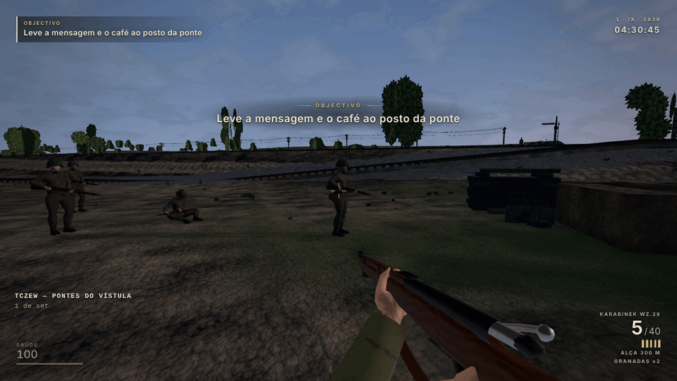 | 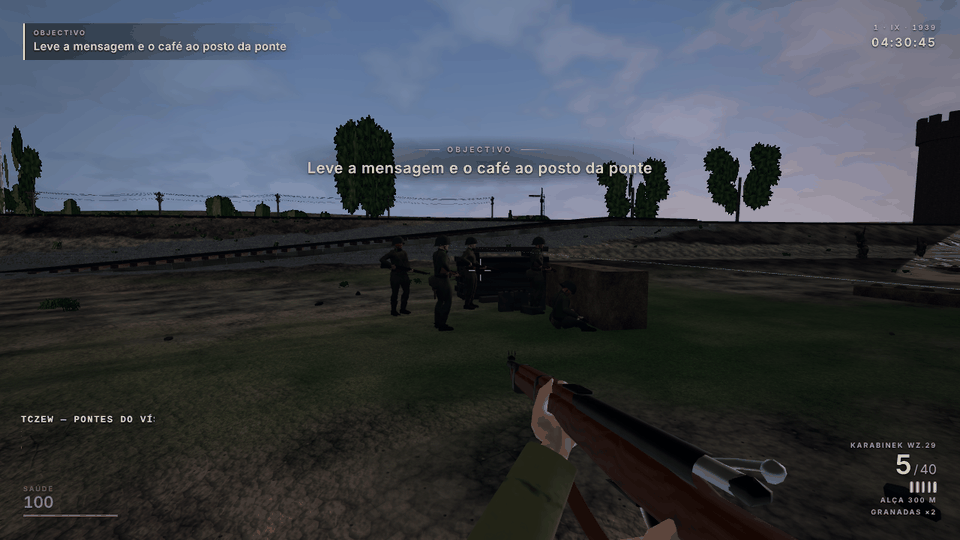 | A secção no posto antes de qualquer fogo: de pé, mas em lugares desencontrados atrás dos sacos (antes, fila de pé). de pé 17, de joelhos 3 (os sapadores ao cabo), ferido 1 |
| `01b-section-under-fire` (04:48:08) | 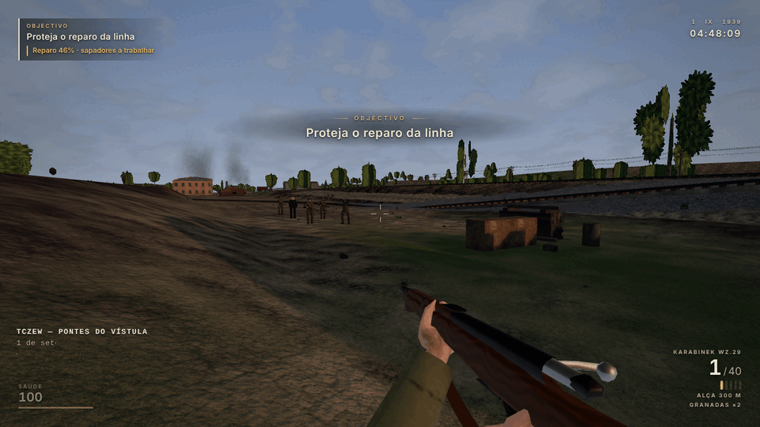 | 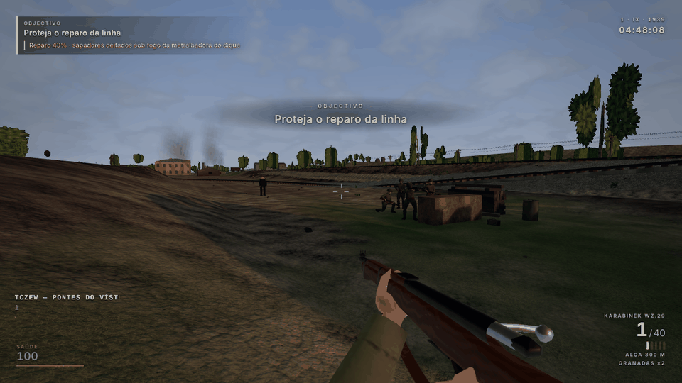 | Depois do bombardeamento das 04:34, a rkm a responder à MG: Bąk e Pawlak de joelhos (desenhados «pinned» porque suprimidos), a voz do pelotão de joelhos, Kowal de pé por cima dos sacos 0,25 s antes de uma rajada (estado da simulação neste instante); Marek, o sargento, está longe com o jogador. de pé 39, de joelhos 36, «pinned» 2, deitados 3 |
| `11-repair-threat-sappers-pinned` (04:47:33) | 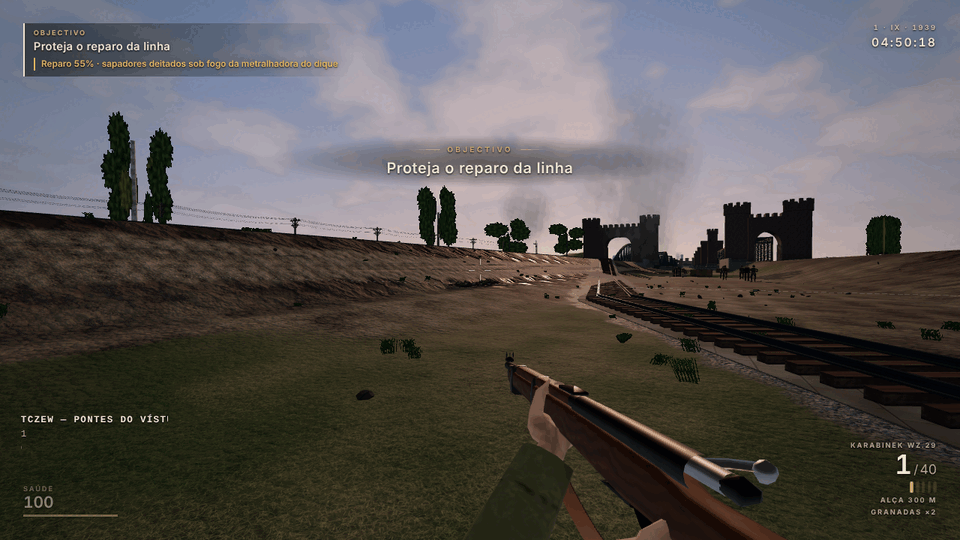 | 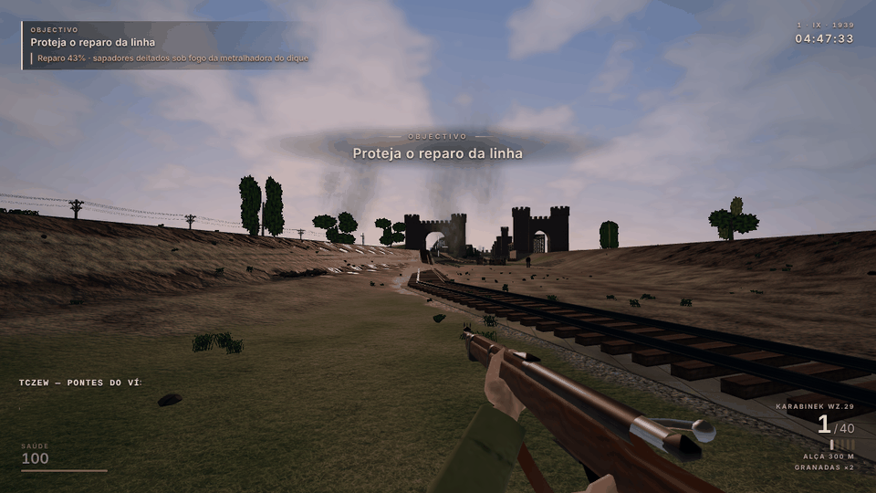 | Vista do roteiro: os sapadores deitados no segundo corte sob a MG (HUD: «sapadores deitados sob fogo da metralhadora do dique»); a esta distância são pontos baixos na encosta. deitados 3 |
| `11b-sappers-close` (04:47:34) | 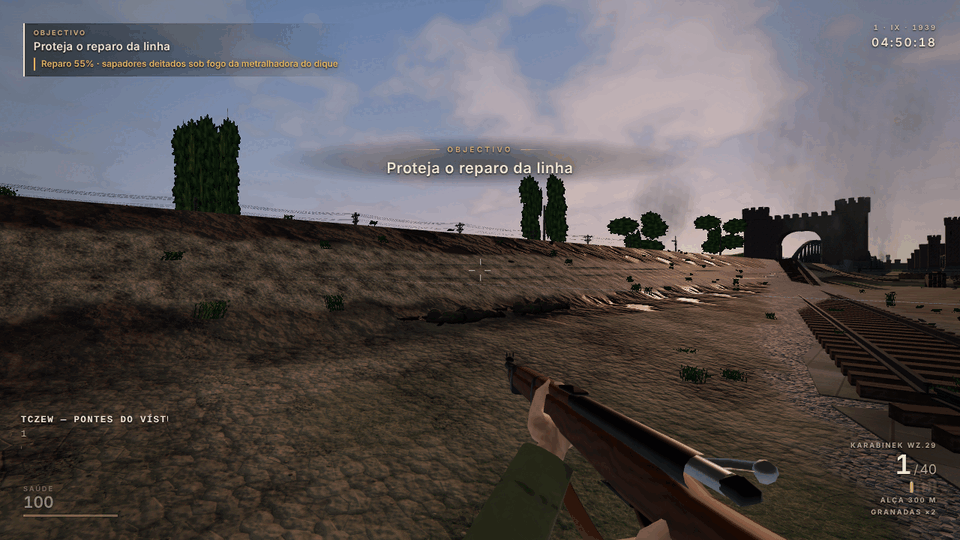 | 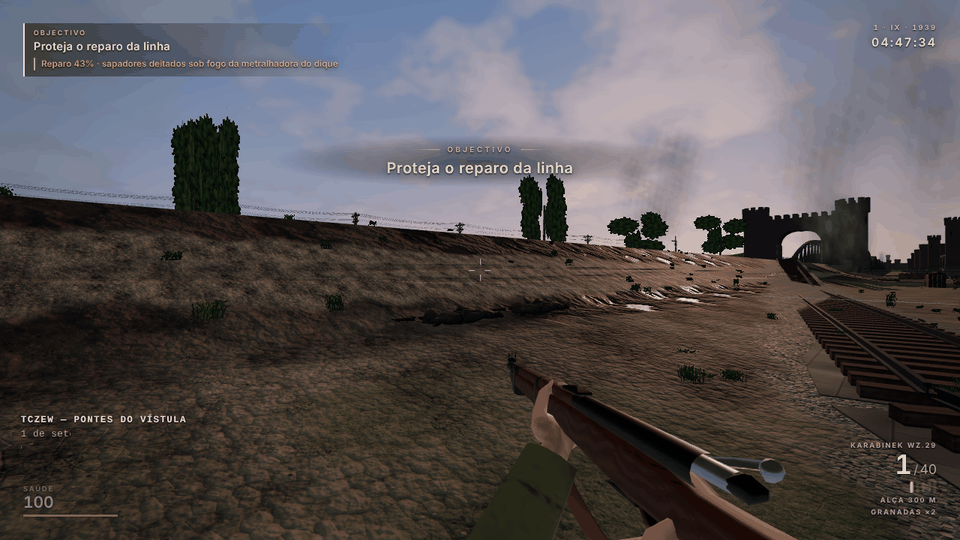 | Os sapadores de perto: deitados (T07), silhueta rasa, espingarda ao lado (antes, de pé em fila junto ao cabo). deitados 3 |
| `21-east-platoon-hold` (05:08:28) |  | 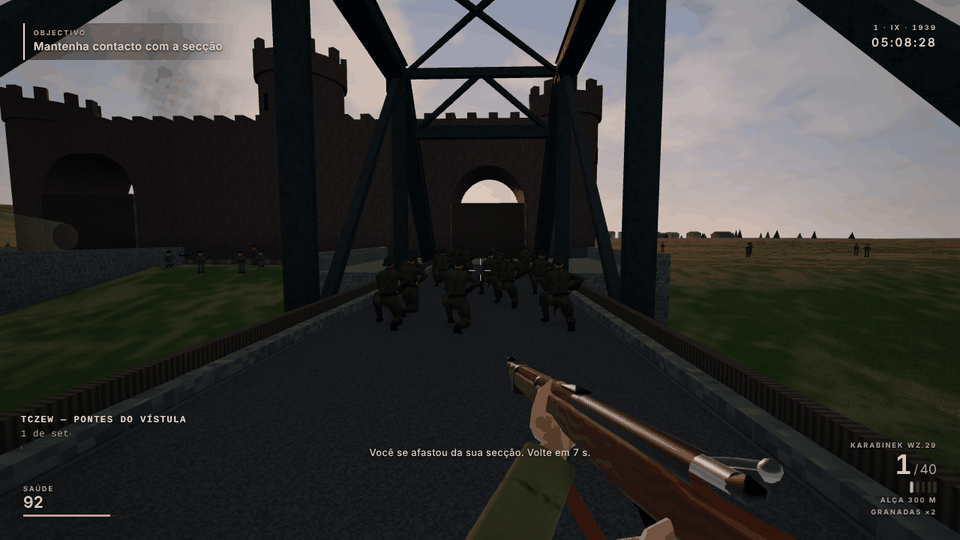 | O pelotão leste a segurar o fim do tabuleiro: de joelhos, em lugares desencontrados e com corpos virados de maneira diferente (antes, um bloco de pé). de joelhos 34, de pé 40 (o resto do campo), deitados 3 |
| `22-gate-riflemen` (05:08:28) | 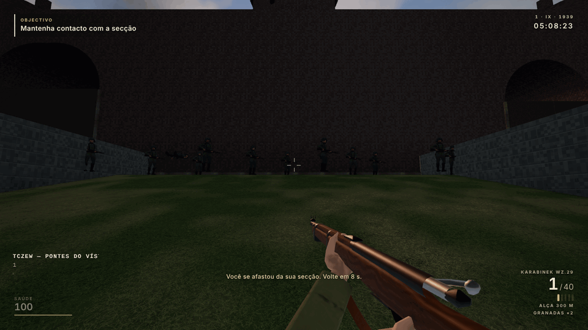 | 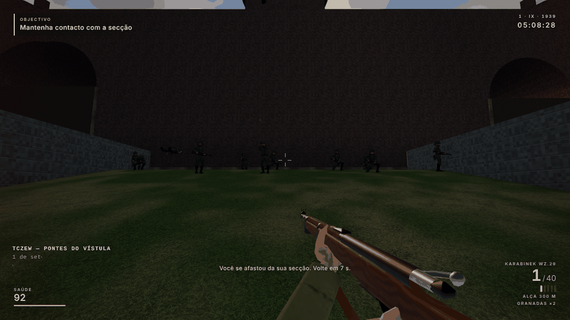 | Os atiradores dos portões vistos do tabuleiro, contra o portal de 1912: desencontrados em profundidade, uns de joelhos e uns poucos de pé (os que se levantaram para disparar); à esquerda, o artilheiro deitado da MG34. Não há cobertura nova: ver a decisão pendente |

Limites da evidência: imagens SwiftShader de uma só rota e de um só instante por vista; não provam o jogo ao longo do tempo (isso são os testes por tick) nem medem FPS.

## Limitações

- Evidência local de uma máquina partilhada e sobrecarregada; sem CI x86 completo, sem revisão crítica independente da versão final e sem playtest humano. T38 continua `DELIVERED_BRANCH`.
- Cobertura real vinda de oeste para os atiradores dos portões: decisão de design por tomar (precisa de novos props de cobertura).
- `m01-postprocess-grading` (9 testes) precisa de `M01_GRADING_BEFORE_DIR` (ver `DEVELOPMENT_STATUS.md`, grupo A) e não foi corrido.
