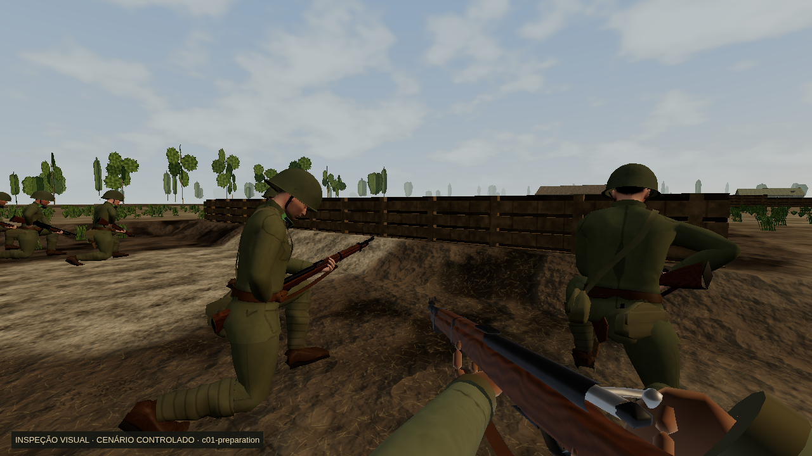
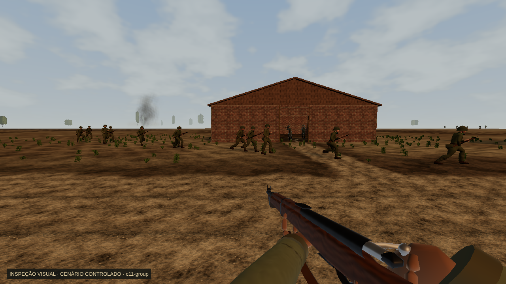
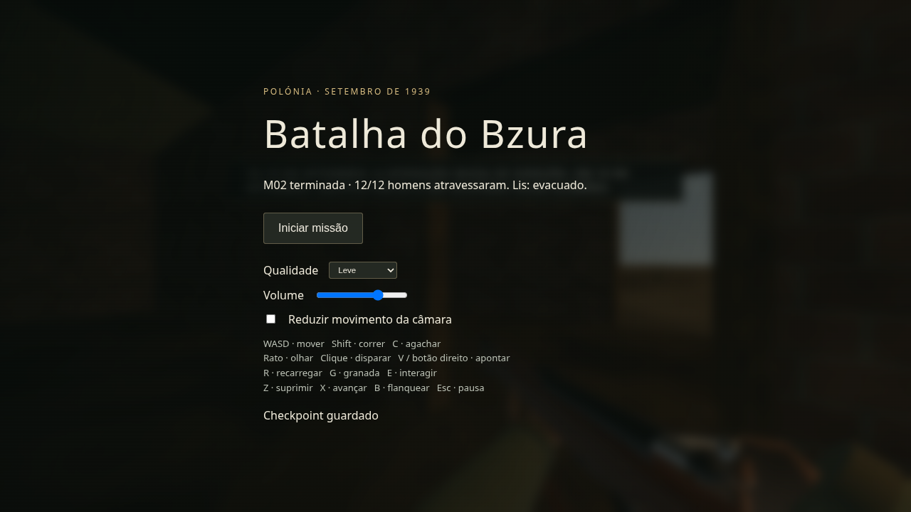

# M02 — entrega E1–E3 e candidata para avaliação humana

2026-10-27. Branch `codex/m02-recovery-v1`. Código de jogo final: **`21f8d67bc7fa75662a3d2b11dbd2e63cac73f1dd`**. Commits de implementação: E1 `9a51249`, E2 `294a6c7`, E3 `21f8d67`. Os commits seguintes desta entrega só guardam documentação/provas; não alteram a build jogada.

A missão funcional C01–C12 está preparada para avaliação humana com a especificação disponível. Não é aprovação artística, equivalência a COD/AAA ou prova de superioridade à M01. O complemento de 173.148 palavras ainda não foi recebido. Fontes/assets proprietários desses jogos não foram utilizados. As tentativas de consultar os manuais/páginas oficiais deram proxy 403, conforme a análise anterior.

## O que mudou no jogo

- E1: MP38 com carregador/alavanca móveis, oito clips próprios derivados M01, contactos por IK M01 e recarga no tempo autoritativo de 2,7 s; bancada MG sem sobrepor o corpo; passos por distância usando amostradores M01; restauro invalida blends/arma mesmo na mesma célula e relógio.
- E2: trincheira P1 escavada 42 cm e EA0 32 cm, rampas e amostragem de malha coerentes com física/balística; EA0 usa parapeito à frente dos defensores e ponto realmente observado; vegetação baixa de flanco e sacaria/caixas GLB M01 nos sólidos existentes.
- E3: os 12 homens de C11 usam navegação/portas/colisão, respeitam atrasos/velocidade e deixam de atravessar obstáculos; LG03/LG09 caminham desarmados; movimento efetivo/odómetro alimentam os clips; impacto/morte animados a partir de acertos reais; tiros bloqueados junto da origem não suprimem alvos distantes.

Dano, capacidades, guarnições, os 12 IDs, falas/roteiro, checkpoints, RNG e consequências M03 preservados. Campos novos de movimento/reação são opcionais para saves antigos e validados antes de mutação. A simulação continua independente da apresentação. Nesta continuação não foram modificados os fontes/assets M01 partilhados.

## Validação da build final

| Prova | Resultado | Fonte |
| --- | --- | --- |
| Node M02 | 80 PASS, 0 FAIL/CANCELLED | [node.txt](final/node.txt) |
| Sistemas M01 partilhados focados | 26 PASS: IK/contacto e áudio/passos | [shared-node.txt](e3/shared-node.txt) |
| Build de produção | PASS, aviso de bundle grande preservado | [build.txt](final/build.txt) |
| GLB MP38 | Reprodução byte a byte PASS (`build.mjs --check`) | [validation.json](final/validation.json) |
| Browser completo | 5 PASS em 3,7 min, 16 capturas novas | [browser.txt](final/browser.txt), [galeria](final/browser/) |
| Áudio por gesto/input | contexto running, pico 0,1544576436 | [browser.txt](final/browser.txt) |
| Percurso contínuo | C01–C12, epílogo/debrief e M03; 0 mortes/erros; vida 32 | [native/report.json](final/native/report.json), [native.txt](final/native.txt) |
| Morte/restauro independentes | fogo real mata aos 16,70 s; checkpoint inicial retomado aos 0,05 s, vida 100, posição preservada | [checkpoint/report.json](final/checkpoint/report.json), [checkpoint.txt](final/checkpoint.txt) |

O percurso final entregou água/munições, marcou o ferido do pomar com giz, evacuou Lis fisicamente e fez os **12/12** atravessarem. Malek terminou incapacitado; não foi curado para passar o teste. Aplicou TR01–TR05 e conservou a condição/fala canónica de Lis no pacote M03. Clock final no debrief: 278,65 s simulados. Método: build congelada de produção, teclado de Playwright e eventos relativos no listener de rato. O planner lê atores/colisões, inclusive posições ocultas, para escolher rota; nunca escreve vida, inimigos, objetivos, tempo/RNG ou saves. Não é playtest humano. Low/480 × 270 no percurso e debrief 1280 × 720; não usar a duração para alegar FPS.

O diretório browser final estava vazio no início. O caso longo passou em 2,5 min, abaixo do limite original de 240 s; não usou cache de capturas nem alterou asserções/timeouts. Essas imagens são da bancada de testes, com fixtures/comandos técnicos, e não do percurso contínuo. O spec usa argumentos sintéticos na telemetria final: **esses FPS não são benchmark**. O pico de áudio confirma sinal, não preferência/qualidade sonora humana.

A suite global M01/M02 anterior foi interrompida com 101 PASS, 0 FAIL, 172 CANCELLED. Não foi repetida nesta etapa porque M01 não mudou; não é declarada aprovada. Os 112 testes partilhados aprovados na etapa anterior têm logs históricos próprios. CI remoto não verificado. A API GitHub voltou a devolver `Post https://api.github.com/graphql: Forbidden` na consulta de PR; push Git normal da candidata funciona. Não foi criado/declarado PR sem resposta válida.

## Capturas High e proveniência

As inspeções seguintes são renderização real no Chromium/SwiftShader, 1280 × 720, com o cenário pausado e rótulo **INSPEÇÃO VISUAL · CENÁRIO CONTROLADO**. Não são fotomontagens nem playtests contínuos. Os relatórios guardam SHA e árvore suja da altura; os diffs descritos abaixo identificam qual implementação fotografam. Múltiplos perfis/LODs permanecem selecionáveis; não há declaração de desempenho em GPU física.

| Pasta | O que demonstra / limite |
| --- | --- |
| `e1/` | MP38 e bancada MG corrigida. Capturada durante E1, antes do commit. |
| `e1/reload-after-restore/` | Fotografias válidas da extração/inserção/alavanca, após corrigir blends antigos no restauro de mesmo relógio. As primeiras sondagens de recarga anteriores à correção não validam a pose corrigida. |
| `e2/landscape-before-trench/` | Paisagem/props em três áreas, antes da vala física final. Não prova o perfil final de P1. |
| `e2/trenches/` | P1 final: piso/rampas/preparação e aproximação C02. Capturada durante E2 antes do commit. |
| `e3/c11-inspection/` | Navegação/posturas iniciais E3; anterior ao refinamento final de supressão e timestamps de impacto. Não é a última prova da caminhada apoiada. |
| `final/c11/` | Repetição final de grupo e Lis no código `21f8d67`; árvore suja apenas por documentação/provas. Report distingue todos os atores/clips/estado. |
| `final/native/` | Capturas do percurso por controlos e cartões/debrief. Perfil Leve salvo debrief 1280 × 720. |
| `final/checkpoint/` | Morte real e retoma; prova separada do percurso sem mortes. |

## Revisão humana e continuidade

Usar [M02_REVIEW_GUIDE.md](../../../m02/M02_REVIEW_GUIDE.md) para jogar e registar defeitos com seed/checkpoint/cena/perfil. O roteiro disponível e a primeira especificação foram respeitados. Incorporar o índice/capítulos relevantes do complemento quando for anexado, sem repetir implementações válidas.

Permanecem questões artísticas: soldados/mãos provisórios da M01, naturalidade/variante da MP38, coreografia de servente MG (o auxiliar atual continua combatente, sem nova alimentação deitado), composição/variedade/ritmo, som e acessibilidade. Não há vozes gravadas novas. Comparar com M01 no mesmo equipamento/perfil e medir GPU física antes de aprovar qualidade. A conclusão funcional não decide essa aprovação.

Main não alterada, sem deploy, merge ou force-push. Reproduzir comandos/ambiente pelo [handoff](../../../m02/M02_EXECUTION_STATE.md). Não repetir recuperação de branches, rajadas causais, MP38 articulada, trincheiras ou navegação C11 já demonstradas.
